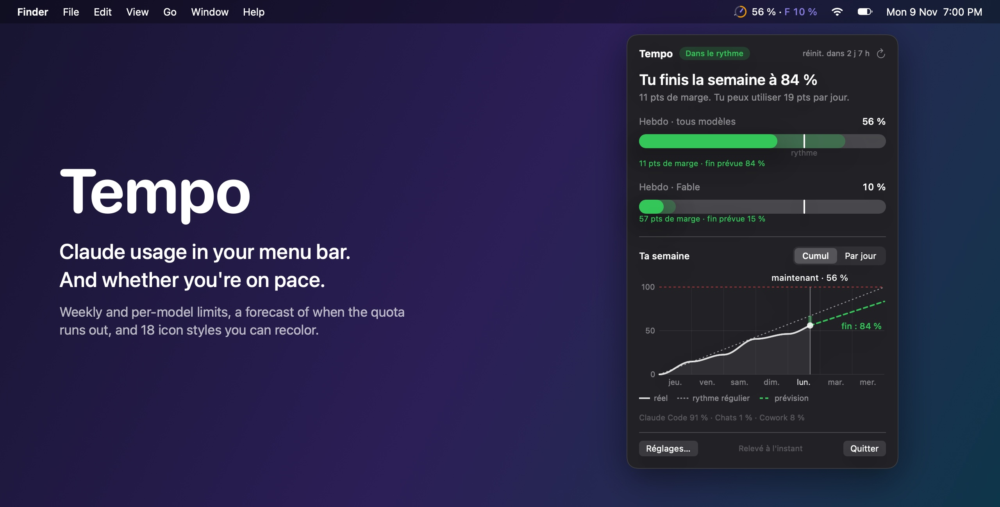
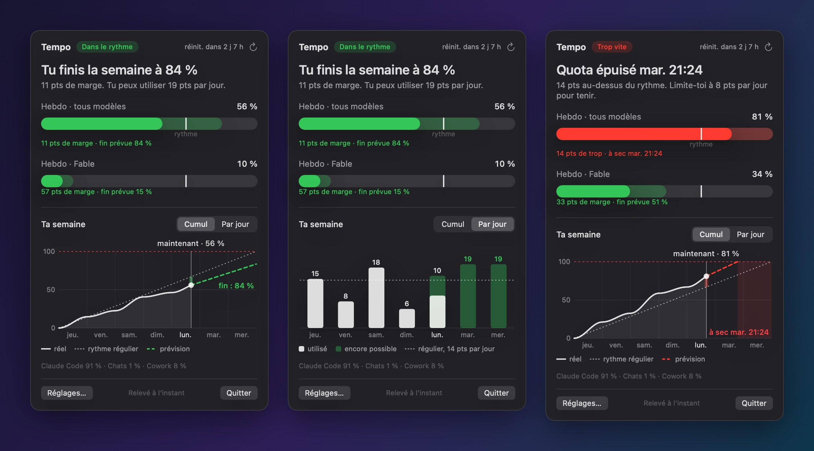
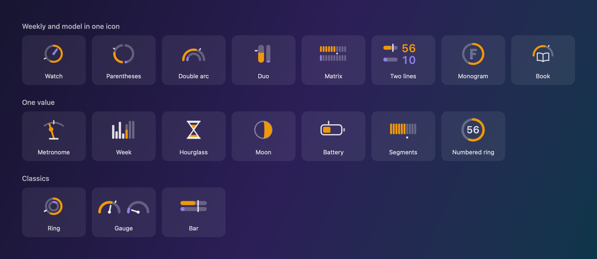
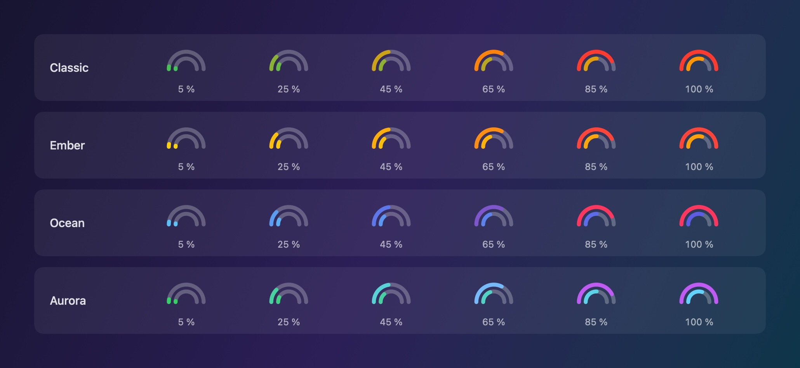

<p align="center">
  
</p>

<h1 align="center">Tempo</h1>

<p align="center">
  A native macOS menu bar app that shows your Claude usage limits,<br>
  and tells you whether you are on pace to run out before the weekly reset.
</p>

<p align="center">
  
  
  
  
</p>

---

A percentage alone does not tell you much. 56 % used is fine on Wednesday and alarming on Monday.
Tempo compares what you have used with how far you are into the week, then gives you the answer directly:
*you will finish the week at 84 %*, or *your quota runs out Tuesday at 21:24*.

## What it shows

- **Both weekly limits in one icon.** The all-models limit and the per-model limit (for example Fable) share a single menu bar icon, in a style you choose.
- **Pace, not only usage.** A marker on the icon shows where a steady pace would put you right now.
- **A forecast.** Where you will end the week at your current rate, or the day and hour the quota runs out.
- **A daily budget.** How many points per day you can still spend and make it to the reset.
- **Colors that follow the quota.** Icons shift from one color to the next as the quota drains, with thresholds and colors you set.

## The panel

<p align="center">
  
</p>

Click the icon to open the panel. From top to bottom:

1. **The answer first.** One sentence with the forecast, and a status pill: on pace, tight, or too fast.
2. **Bars that include the pace.** The solid part is what you used. The faded part is where you will be at the reset. The vertical line is the steady pace.
3. **Your week, two ways.** *Cumulative* plots real usage against the steady pace and the forecast. *Per day* shows the points used each day and what you can still spend on the remaining days.

## Icon styles

<p align="center">
  
</p>

Eighteen styles in three families: eight that show both limits in one icon, seven that focus on one value, and three classics.
The settings window shows every style as a live preview with your own numbers.

You also choose the text next to the icon: nothing, the percentage, the percentage with the gap to the steady pace, the gap alone, or the forecast.

## Colors

<p align="center">
  
</p>

Four color modes for the weekly limit:

| Mode | The color follows |
| --- | --- |
| Monochrome | Nothing. The icon uses the menu bar text color. |
| Thresholds | Usage, in three steps. |
| Gradient | Usage, blending continuously from one color to the next. |
| Pace | The forecast: on pace, tight, or too fast. |

You pick the three colors yourself or start from a preset (Classic, Ember, Ocean, Aurora), and you set the two thresholds where the color changes.
The per-model limit can use the text color, a fixed color of its own, or the same scale driven by its own usage.
A simulator in the settings sweeps usage from 0 to 100 % so you can see the colors change without waiting for your quota to move.

## Install

Tempo is built from source. You need macOS 14 or later and a Swift 5.9+ toolchain (Xcode 15 or later).

```bash
git clone https://github.com/tofunori/tempo-menubar.git
cd tempo-menubar
./install.sh
```

`install.sh` builds a release binary, wraps it in `Tempo.app`, copies it to `/Applications`, and launches it.
To build without installing, run `./build.sh`; the app lands in `build/Tempo.app`.

Tempo has no login screen. It reuses the session that [Claude Code](https://claude.com/claude-code) keeps in your Keychain, so you need Claude Code installed and signed in with a Claude subscription on the same Mac.

## How it works

- **Data.** Tempo calls the same usage endpoint that Claude Code's `/usage` command reads, `api.anthropic.com/api/oauth/usage`. The response carries each limit's percentage and reset time.
- **Credentials.** The access token is read from the `Claude Code-credentials` Keychain item through `/usr/bin/security`, the way Claude Code itself reads it. The token is sent only to `api.anthropic.com`. It is never logged or written anywhere else.
- **Pace.** The forecast extends your average rate since the start of the weekly window. Tempo also records each reading locally so it can draw your real curve and your per-day usage.
- **Footprint.** AppKit status item, SwiftUI panel created only while it is open, no third-party dependencies. About 14 MB of memory at rest on the machine it was built on.

Local files live in `~/Library/Application Support/Tempo/`: the reading history and the last response from the service.

## Limits you should know about

- **The usage endpoint is undocumented.** Anthropic can change or remove it without notice, and Tempo would stop working until it is updated.
- **The endpoint is rate limited.** Polling every minute got Tempo refused for more than twenty minutes during development. Tempo now polls every 15 minutes by default, never more often than every 5, keeps showing the last reading while it waits, and backs off after a refusal.
- **Claude Code renews the token.** Tempo does not refresh it. If the token expires, the icon dims and the panel asks you to open Claude Code.
- **The per-day view needs history.** Days before Tempo was installed appear as a smoothed ramp, because Tempo only knows the total. The view is exact from the next weekly reset on.
- **The interface is in French.** The app was built for a French-speaking user. An English localization is not done yet.
- **Tested on one setup.** Built and used on macOS 27 with Swift 6.4 on Apple silicon. The package targets macOS 14, but earlier versions are untested.
- **Ad hoc signature.** The app is signed locally, without an Apple developer certificate. If macOS blocks it, right-click the app and choose Open.

## Checking it without the app

The binary has a few flags for inspecting its output from a terminal:

```bash
.build/release/Tempo --dump                  # read usage, print limits, pace and menu bar text
.build/release/Tempo --icons sheet.png       # draw every icon style, light and dark
.build/release/Tempo --panel panel.png       # draw the panel off screen with sample data
.build/release/Tempo --readme-assets docs    # regenerate the images in this README
```

The images in this README come from `--readme-assets`. They are drawn by the app's own rendering code with fixed sample data, not captured from a screen.

## Project layout

| File | Role |
| --- | --- |
| `UsageClient.swift` | Reads the token, calls the usage endpoint, caches the last response |
| `Models.swift` | The service response and the limits Tempo works with |
| `Pace.swift` | Forecast, gap to the steady pace, daily budget, per-day usage |
| `History.swift`, `UsageStore.swift` | Local history, polling, backoff |
| `IconStyles.swift`, `IconRenderer.swift` | The eighteen icon styles, drawn with Core Graphics |
| `MenuBarContent.swift`, `StatusController.swift` | The status item: icon, text, panel |
| `PopoverView.swift`, `Charts.swift` | The panel and its two charts |
| `SettingsView.swift`, `Settings.swift` | The settings window and what it stores |
| `DebugTools.swift`, `ReadmeAssets.swift` | The command line flags above |

## Disclaimer

Tempo is an independent project. It is not made, endorsed, or supported by Anthropic. Claude and Claude Code are trademarks of Anthropic.

## License

[MIT](LICENSE)
