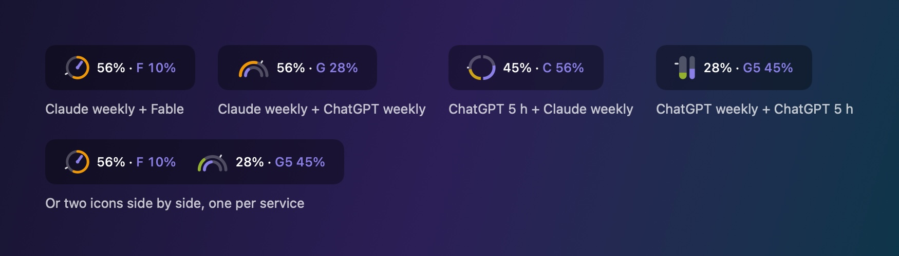

<p align="center">
  
</p>

<h1 align="center">Tempo</h1>

<p align="center">
  A native macOS menu bar app that shows your Claude and ChatGPT usage limits,<br>
  and tells you whether you are on pace to run out before the reset.
</p>

<p align="center">
  
  
  
  
</p>

---

A percentage alone does not tell you much. 56 % used is fine on Wednesday and alarming on Monday.
Tempo compares what you have used with how far you are into the window, then gives you the answer directly:
*you will finish the week at 84 %*, or *your quota runs out Tuesday at 21:24*.

## What it shows

- **Claude and ChatGPT.** Claude's weekly limits, and the 5-hour and weekly limits of Codex on a ChatGPT plan.
- **Any two values in one icon.** Each icon shows the pair you pick: Claude weekly with its per-model limit, Claude weekly with ChatGPT weekly, ChatGPT's 5-hour window with Claude weekly, and so on.
- **One icon or two.** Keep everything in a single icon, or add a second one with its own values and style.
- **Pace, not only usage.** A marker on the icon shows where a steady pace would put you right now.
- **A forecast.** Where you will end the window at your current rate, or the day and hour the quota runs out.
- **A daily budget.** How many points per day you can still spend and make it to the reset.
- **Colors that follow the quota.** Icons shift from one color to the next as the quota drains, with thresholds and colors you set.
- **English and French.** The interface follows your system language, or the one you pick in the settings.

## Combinations

<p align="center">
  
</p>

Five values are available, and every icon takes a first value and an optional second one:

| Value | What it tracks |
| --- | --- |
| Claude · weekly | The weekly limit across all models |
| Claude · model | The weekly limit Claude applies to one model (for example Fable) |
| Claude · 5 h | The 5-hour session window, on plans that have one |
| ChatGPT · 5 h | Codex's 5-hour window |
| ChatGPT · weekly | Codex's weekly limit |

The pace marker, the forecast and the color follow the first value. The second value gets its own color, so you can tell the two apart at a glance.

## The panel

<p align="center">
  
</p>

Click an icon to open the panel. From top to bottom:

1. **The answer first.** One sentence with the forecast for the icon's first value, and a status pill: on pace, tight, or too fast.
2. **Bars that include the pace.** The solid part is what you used. The faded part is where you will be at the reset. The vertical line is the steady pace. With both services, each one gets its own block.
3. **Your week, two ways.** *Cumulative* plots real usage against the steady pace and the forecast. *Per day* shows the points used each day and what you can still spend on the remaining days.

## Icon styles

<p align="center">
  
</p>

Eighteen styles in three families: eight that show two values in one icon, seven that focus on one value, and three classics.
The settings window shows every style as a live preview with your own numbers.

You also choose the text next to the icon: nothing, the percentage, the percentage with the gap to the steady pace, the gap alone, or the forecast.
Each icon has a size setting, from 70 % to 130 %, that scales the drawing and its text together. The drawing stops growing when it reaches the height of the menu bar.

## Colors

<p align="center">
  
</p>

Four color modes for the first value:

| Mode | The color follows |
| --- | --- |
| Monochrome | Nothing. The icon uses the menu bar text color. |
| Thresholds | Usage, in three steps. |
| Gradient | Usage, blending continuously from one color to the next. |
| Pace | The forecast: on pace, tight, or too fast. |

You pick the three colors yourself or start from a preset (Classic, Ember, Ocean, Aurora), and you set the two thresholds where the color changes.
The second value can use the text color, a fixed color of its own, or the same scale driven by its own usage.
A simulator in the settings sweeps usage from 0 to 100 % so you can see the colors change without waiting for your quota to move.

## Install

Tempo is built from source. You need macOS 14 or later and a Swift 5.9+ toolchain (Xcode 15 or later).

```bash
git clone https://github.com/tofunori/tempo-menubar.git
cd tempo-menubar
./install.sh
```

`install.sh` builds a release binary, wraps it in `Tempo.app`, copies it to `/Applications`, and launches it.
To build without installing, run `./build.sh`; the app lands in `build/Tempo.app`.

Tempo has no login screen. It reuses what the official tools already keep on your Mac:

- **Claude** needs [Claude Code](https://claude.com/claude-code) installed and signed in with a Claude subscription.
- **ChatGPT** needs the Codex CLI or app signed in with a ChatGPT plan, and used at least once on this Mac. It is optional: without it, Tempo shows Claude only.

## How it works

- **Claude data.** Tempo calls the same usage endpoint that Claude Code's `/usage` command reads, `api.anthropic.com/api/oauth/usage`. The response carries each limit's percentage and reset time.
- **Claude credentials.** The access token is read from the `Claude Code-credentials` Keychain item through `/usr/bin/security`, the way Claude Code itself reads it. The token is sent only to `api.anthropic.com`. It is never logged or written anywhere else.
- **ChatGPT data.** Codex writes its rate limits into its session files under `~/.codex/sessions`. Tempo reads the most recent entry from those files. It makes no network request for ChatGPT and never touches the Codex credentials.
- **Pace.** The forecast extends your average rate since the start of the window. Tempo also records each reading locally so it can draw your real curve and your per-day usage.
- **Footprint.** AppKit status items, SwiftUI panel created only while it is open, no third-party dependencies. Between 14 and 30 MB of memory at rest on the machine it was built on.

Local files live in `~/Library/Application Support/Tempo/`: the reading history and the last response from the Claude service.

## Limits you should know about

- **The Claude usage endpoint is undocumented.** Anthropic can change or remove it without notice, and Tempo would stop working until it is updated.
- **The Claude endpoint is rate limited.** Polling every minute got Tempo refused for more than twenty minutes during development. Tempo now polls every 15 minutes by default, never more often than every 5, keeps showing the last reading while it waits, and backs off after a refusal.
- **Claude Code renews the token.** Tempo does not refresh it. If the token expires, the icon dims and the panel asks you to open Claude Code.
- **ChatGPT figures are as fresh as your last Codex session on this Mac.** Usage from another machine or from the web does not show up until Codex runs here again. The panel says how old the reading is. The session file format is not documented either and can change.
- **ChatGPT means Codex.** Tempo shows the Codex limits of a ChatGPT plan. It has no source for the message caps of the ChatGPT chat app.
- **The per-day view needs history.** Days before Tempo was installed appear as a smoothed ramp, because Tempo only knows the total. The view is exact from the next weekly reset on.
- **Tested on one setup.** Built and used on macOS 27 with Swift 6.4 on Apple silicon, with Codex CLI 0.167. The package targets macOS 14, but earlier versions are untested.
- **Ad hoc signature.** The app is signed locally, without an Apple developer certificate. If macOS blocks it, right-click the app and choose Open.

## Checking it without the app

The binary has a few flags for inspecting its output from a terminal:

```bash
.build/release/Tempo --dump                  # read both services, print limits, pace and menu bar text
.build/release/Tempo --dump local            # same, without calling the Claude service
.build/release/Tempo --icons sheet.png       # draw every icon style, light and dark
.build/release/Tempo --panel panel.png       # draw the panel off screen with sample data
.build/release/Tempo --panel panel.png live  # draw it with your cached Claude reading and local Codex data
.build/release/Tempo --readme-assets docs    # regenerate the images in this README
```

The images in this README come from `--readme-assets`. They are drawn by the app's own rendering code with fixed sample data, not captured from a screen.

## Project layout

| File | Role |
| --- | --- |
| `UsageClient.swift` | Reads the Claude token, calls the usage endpoint, caches the last response |
| `CodexUsage.swift` | Reads the ChatGPT limits from local Codex session files |
| `Models.swift` | Services, limits, and the values an icon can show |
| `Pace.swift` | Forecast, gap to the steady pace, daily budget, per-day usage |
| `History.swift`, `UsageStore.swift` | Local history, polling, backoff |
| `IconStyles.swift`, `IconRenderer.swift` | The eighteen icon styles, drawn with Core Graphics |
| `MenuBarContent.swift`, `StatusController.swift` | The status items: icon, text, panel |
| `PopoverView.swift`, `Charts.swift` | The panel and its two charts |
| `SettingsView.swift`, `Settings.swift` | The settings window and what it stores |
| `L10n.swift`, `Format.swift` | English and French text, dates and numbers |
| `DebugTools.swift`, `ReadmeAssets.swift` | The command line flags above |

## Disclaimer

Tempo is an independent project. It is not made, endorsed, or supported by Anthropic or OpenAI. Claude and Claude Code are trademarks of Anthropic. ChatGPT and Codex are trademarks of OpenAI.

## License

[MIT](LICENSE)
